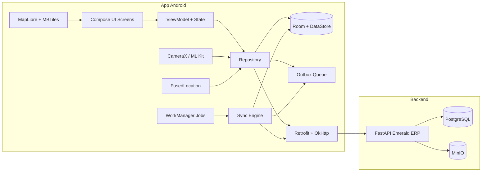

# Plan: App Android Offline-First para Técnicos de OT

## 1. Objetivo

Desarrollar una app Android nativa, robusta y offline-first que cumpla el rol de la vista web de técnicos del módulo de OT (Work Orders), con la capacidad de evolucionar hacia funciones avanzadas (configuración automática de equipos, mapas offline, etc.). La web actual se mantiene como fallback.

## 2. Análisis del estado actual (rol del técnico en la web)

### 2.1 Flujo actual

| Pantalla | Componente | Qué hace |
|----------|------------|----------|
| Listado | [`WorkOrdersPage.jsx`](frontend/src/pages/WorkOrdersPage.jsx:133) | Listado paginado con filtros server-side (status, tipo, búsqueda, cuadrilla), agenda del día agrupada por turno, bloqueo por OT vencida (`pending_closure`), inspección diaria de vehículo |
| Ejecución | [`WorkOrderExecutionPage.jsx`](frontend/src/pages/WorkOrderExecutionPage.jsx:136) | Datos del cliente, teléfono (`tel:`), dirección, abrir Google Maps, actualizar ubicación (lat/lng), PPPoE/plan/nodo/VLAN, diagnóstico remoto Beholder, iniciar / cancelar / completar |
| Cierre | [`CloseWorkOrderDialog.jsx`](frontend/src/components/work-orders/CloseWorkOrderDialog.jsx:30) | Wizard de 3 pasos: acción de resolución + narrativa, materiales (escáner/seriales), fotos con compresión |
| Extras | `recovery`, notas de conexión, intentos de contacto | Recuperación de equipos, notas de conexión, registro de intentos de contacto |

### 2.2 Endpoints reutilizables (`/api/v2/work-orders`)

Definidos en [`work_orders.py`](backend/src/routers/work_orders.py:88):

- `GET /` — listado con filtros y scope automático por rol/capability.
- `GET /my-schedule` — agenda del día.
- `GET /my-pending-closure` — OTs vencidas que bloquean la agenda.
- `GET /{id}` — detalle completo (incluye `ticket_info` con cliente, dirección, PPPoE, nodo, VLAN).
- `PATCH /{id}` — iniciar trabajo (`status=in_progress`, `started_at`), actualizar datos.
- `POST /{id}/items` / `DELETE /{id}/items/{item_id}` — materiales consumidos.
- `POST /{id}/recovery` — recuperación de equipos.
- `GET /updates/pending`, `GET /{id}/updates`, `POST /{id}/updates`, `PATCH /updates/{id}/status` — novedades/actualizaciones.
- `PUT /{id}/reopen` — reabrir.
- `POST /{id}/cancel`, `POST /{id}/cancel-start`, `POST /{id}/mark-incomplete`.
- `POST /{id}/contact-attempts`, `GET /{id}/contact-attempts`, `GET /{id}/contact-attempts/stats`.
- `POST /{id}/complete` — cierre transaccional con idempotencia (`close_idempotency_key`), inventario, fotos.
- `GET /{id}/connection-assets`, `GET /{id}/connection-notes`, `POST /connection-notes`.

Servicios de apoyo:

- Auth: `POST /api/v1/auth/login` (OAuth2 password, form-urlencoded), `POST /api/v1/auth/refresh`, `GET /api/v1/auth/me` — [`auth.py`](backend/src/routers/v1/auth.py:47).
- Fotos: `POST /api/v2/tickets/{ticket_id}/attachments` (multipart, MinIO) — [`tickets_v2_attachment.py`](backend/src/routers/tickets_v2_attachment.py:48).
- Diagnóstico Beholder: `GET /diagnosis/{pppoe}` — [`beholder.service.js`](frontend/src/services/beholder.service.js:30).
- Flota (inspección de vehículo): router `fleet` — [`main.py`](backend/src/main.py:187).
- Cuadrillas: router `coordination` — [`main.py`](backend/src/main.py:181).

### 2.3 Stack actual

- Backend: FastAPI + SQLAlchemy + PostgreSQL + Alembic + JWT HS256 + MinIO.
- Frontend: React 19 + Vite + Tailwind + axios. **Sin PWA ni service worker** (verificado: no hay `manifest.json` ni `vite-plugin-pwa`).
- RBAC: capabilities `recurso.accion` vía [`build_capabilities`](backend/src/core/security.py:395).

## 3. Factibilidad

**Alta.** La API ya está desacoplada del frontend y cubre el 100% del flujo del técnico; la app Android es un cliente más del mismo backend. No hay que reescribir lógica de negocio.

Puntos a favor:

- Los endpoints ya aplican scope por rol (un técnico solo ve sus OTs y las de su cuadrilla).
- El cierre ya es idempotente (`close_idempotency_key`), ideal para reintentos en redes inestables.
- Las fotos ya se suben por multipart a MinIO vía backend.

Brechas a resolver (ver sección 5).

## 4. Recomendación de lenguaje

**Kotlin + Jetpack Compose, con estrategia Kotlin Multiplatform (KMP/Compose Multiplatform).**

Justificación frente a alternativas:

| Criterio | Kotlin/Compose (recomendado) | Flutter | React Native/Expo |
|----------|------------------------------|---------|-------------------|
| Offline-first (Room + WorkManager + DataStore) | Excelente, nativo | Bueno (Drift/Isar + background isolates) | Regular (SQLite + libs JS, background limitado) |
| Cámara/GPS/escáner/background | Acceso nativo total (CameraX, FusedLocation, ML Kit, Foreground Service) | Plugins, a veces necesitan código nativo | Muy dependiente de librerías |
| Configuración de equipos a futuro (Wi-Fi provisioning, TR-069, sockets/SSH) | Acceso directo a APIs de red del SO | Requiere platform channels | Requiere módulos nativos |
| Portabilidad (iOS futuro) | KMP/Compose Multiplatform | Excelente | Excelente |
| Curva con el equipo actual (JS) | Media | Media | Baja |
| Robustez a largo plazo | Máxima (Google, lenguaje oficial Android) | Muy alta | Alta |

Conclusión: Kotlin nativo es la opción más sólida para offline-first y para el roadmap de configuración automática de equipos. Estructurar el código con KMP (lógica de negocio compartida en Kotlin puro, UI nativa Compose) deja la puerta abierta a iOS sin reescribir la lógica.

## 5. Arquitectura propuesta (offline-first)

Principios:

1. **La BD local (Room) es la fuente de verdad en el dispositivo.** La UI nunca depende de la red.
2. **Outbox/cola de operaciones:** cada mutación (iniciar, completar, materiales, fotos) se escribe primero localmente con estado `pending` y un `idempotency_key`; un `WorkManager` con `NetworkType.CONNECTED` y backoff exponencial la despacha.
3. **Sincronización de lectura:** al abrir la app (o vía pull-to-refresh / periodic work) se descarga la agenda del día + OTs asignadas y se persisten para consulta sin señal.
4. **Fotos:** se comprimen en el dispositivo (Bitmap/Canvas o `ImageDecoder`), se encolan y se suben a MinIO vía el endpoint de attachments; la OT se cierra solo cuando las fotos están subidas.
5. **Mapas offline:** MapLibre GL Native + paquetes MBTiles por zona, con `lat/lng` ya disponibles en la OT. Alternativa comercial: SDK de Mapbox/Google Maps offline (requiere licencia).
6. **Autenticación:** login contra `/api/v1/auth/login`, refresh con `/api/v1/auth/refresh`, tokens en `EncryptedSharedPreferences`/DataStore + Keystore. El `idempotency_key` del cierre se genera en el device con UUID.

## 6. Brechas de backend a resolver

1. **Sincronización eficiente:** hoy `GET /work-orders` es paginado sin cursor de cambios. Agregar `GET /work-orders/sync?updated_since=<ts>` (o ETags) para sync incremental y reducir datos en redes pobres.
2. **Notificaciones push:** hoy no hay FCM. Agregar push para avisar nuevas OT asignadas (o al menos polling de `my-schedule` con WorkManager).
3. **Fotos de cierre de OT:** el flujo sube a `tickets/{ticket_id}/attachments` y luego pasa `photo_urls` al `complete`. Funciona, pero conviene un endpoint de "presigned upload" a MinIO para subir directo desde el device y evitar doble tránsito por FastAPI (mejora en redes lentas).
4. **Refresh token de larga duración para dispositivos:** definir política de sesión para móvil (refresh token persistente revocable, o token de dispositivo).
5. **Tracking opcional de posición del técnico:** si se quiere geolocalización en tiempo real, falta un endpoint (es extra, no bloqueante).

## 7. Roadmap de funcionalidades extra (futuro)

- Mapas offline + navegación por zonas.
- Configuración automática de equipos: Wi-Fi provisioning de ONT/ONU y routers, TR-069/TR-369, ejecución de scripts por SSH/API.
- Firma digital del cliente en cierre.
- OCR de DNI (ML Kit) para validar titular.
- Speed test y lectura de potencia óptica (dBm) integrados.

## 8. Plan de implementación por fases

### Fase 0 — Fundaciones del proyecto
- Crear proyecto Android (Kotlin, Compose, MVVM + Repository, Hilt).
- Configurar Retrofit/OkHttp + interceptor de auth y refresh.
- Room + DataStore + Keystore.

### Fase 1 — Auth y sincronización base
- Login/refresh contra endpoints existentes; sesión persistente cifrada.
- Sync de lectura: agenda del día (`my-schedule`), listado (`work-orders`), detalle (`{id}`).
- Estructura de Outbox con `idempotency_key`.

### Fase 2 — Flujos core del técnico
- Listado de OTs con filtros y estado offline.
- Detalle de OT: cliente, tel, dirección, mapa (online primero), PPPoE/plan/nodo.
- Iniciar / cancelar inicio / pausar con estado local + cola de envío.

### Fase 3 — Cierre completo offline
- Wizard de cierre: acción de resolución + narrativa, materiales (escáner ML Kit + seriales), fotos comprimidas.
- Recuperación de equipos, notas de conexión, intentos de contacto.
- Bloqueos: `pending_closure` e inspección de vehículo (integración con `fleet`).

### Fase 4 — Endurecimiento offline
- Mapas offline (MapLibre + MBTiles).
- Sincronización incremental (`updated_since`) y reintentos con backoff.
- Manejo de conflictos y auditoría local.

### Fase 5 — Backend habilitador
- Endpoint de sync incremental.
- Presigned uploads a MinIO para fotos.
- Push notifications (FCM) opcional.

### Fase 6 — Extras (futuro)
- Configuración automática de equipos, OCR, firma digital, speed test.

## 9. Riesgos y decisiones pendientes

- **Distribución:** Play Store vs. APK sideload/MDM (afecta permisos de background y actualizaciones).
- **Licencias de mapas offline:** MapLibre + OSM (gratis) vs. Google/Mapbox (pago).
- **Dispositivos:** confirmar si son smartphones o terminales rugged con escáner láser (cambia integración de escáner: CameraX/ML Kit vs. DataWedge).

## 10. Gobernanza de repositorios y forma de abordarlo

Contexto actual: Emerald ERP ya es un **monorepo** (backend + frontend + beholder_frontend + nginx + docker-compose), ver [`README.md`](README.md:69) y [`docker-compose.yml`](docker-compose.yml:2).

### Recomendación profesional

**Repositorio separado para la app Android + contrato OpenAPI como fuente de verdad.**

Razones:

1. **Toolchain y ciclo de vida distintos.** Android usa Gradle, JDK, Android SDK, firma de APK/AAB, ProGuard/R8 y releases por Play Store/testing tracks. Mezclarlo en el mismo repo acopla los deploys: un hotfix móvil dispararía builds de backend/frontend y viceversa.
2. **CI/CD independiente.** Pipelines con runners Android dedicados, versionado semántico de la app, lanzamientos por feature flags.
3. **El backend sigue siendo la única fuente de verdad de endpoints.** Los endpoints nuevos que requiera la app se agregan en el repo actual del backend, como hasta ahora.

Cómo **no perder el contexto** al separar repos:

- **Contract-first:** el backend FastAPI ya expone el esquema en `/openapi.json` (ver [`main.py`](backend/src/main.py:58)). Se exporta como artefacto versionado y se **genera el cliente Kotlin/DTOs** automáticamente (OpenAPI Generator o KSP). Así el móvil no adivina contratos y el acoplamiento es controlado.
- El repo del móvil referencia una **versión del contrato** (commit/tag del backend) para saber contra qué API compila.
- Los cambios de API se hacen primero en backend, se regenera el cliente, y se versiona el contrato (breaking changes = major).

### Alternativa aceptable (equipo chico que prioriza contexto)

Mantener la app en una carpeta del monorepo (`/mobile/android`) como **proyecto Gradle independiente**, con CI disparado solo por `mobile/**` (path filters). Es viable, pero el repo crece y mezcla toolchains; se vuelve monólito de build si no se disciplina.

### Decisión sugerida

1. Crear repo `emerald-android` (o `emerald-mobile`).
2. Exportar y versionar el contrato OpenAPI del backend.
3. Generar cliente Kotlin a partir del contrato.
4. Registrar las decisiones en ADRs (ver [`docs/adr`](docs/adr/)) para offline-strategy, sync y mapas.

## 11. Información requerida para cubrir el desarrollo

### Contrato y datos

- Exportar `/openapi.json` del backend (dev y prod) para generar el cliente.
- Documentar los JSONB: `work_orders.custom_data` (snapshot `connection`, `internal_subtype`) y `ticket_info` que arma [`get_work_order_detail`](backend/src/routers/work_orders.py:485).
- Catálogo de enums/estados: `WorkOrderStatus`, `WorkOrderType`, `ResolutionCategory`, prioridades.

### Reglas de negocio a codificar

- Bloqueo `pending_closure` ([`get_my_pending_closure`](backend/src/routers/work_orders.py:353)) y bloqueo por inspección de vehículo (fleet).
- Grace period de 5 minutos para OT vencida ([`WorkOrderExecutionPage.jsx`](frontend/src/pages/WorkOrderExecutionPage.jsx:367)).
- Acciones de cierre por tipo de OT (`WO Actions`) y categorías de resolución.
- Reglas de inventario: stock bulk vs. serializado, derivación de `warehouse_id`, reversión de ítems.

### Autenticación y seguridad

- TTLs de access/refresh y política de sesión para dispositivos (ver [`security.py`](backend/src/core/security.py:101)).
- Decidir token de dispositivo revocable vs. refresh de larga duración.
- Requisitos de cifrado local (Keystore/EncryptedSharedPreferences) y manejo de PII.

### Dispositivos y distribución

- ¿Smartphones o rugged con escáner láser? (define escáner CameraX/ML Kit vs. DataWedge).
- Android min SDK objetivo y lista de modelos a soportar.
- Canal de distribución: Play Store, APK sideload o MDM (afecta permisos de background y actualizaciones).

### Entorno y conectividad

- URLs de API por ambiente (dev/staging/prod) y cómo accede el device (VPN/DDNS/dominio público).
- Volúmenes esperados: cantidad de técnicos, OTs/día, fotos por cierre (cantidad y peso), tiempo offline típico.

### UX e integraciones

- Paridad visual con el dark theme web, idioma es-AR.
- Diagnóstico Beholder ([`beholder.service.js`](frontend/src/services/beholder.service.js:30)) y, a futuro, Mikrotik/SmartOLT para auto-configuración.

## 12. Cómo encararlo de forma profesional (resumen)

1. **Contract-first + repos separados + CI/CD independientes.**
2. **Entregas por slices verticales** (login → agenda → detalle → cierre offline), no por capas.
3. **ADRs** para decisiones de fondo (offline strategy, sync, mapas, seguridad).
4. **Backend habilitador** se trabaja en el repo actual; el móvil consume el contrato generado.
5. **Feature flags** para activar gradualmente funciones nuevas (auto-config, OCR) sin romper la web.

## 13. Desarrollo paralelo sin interferencia (expansión opcional)

Requisito rector: la app es una **expansión opcional** que jamás debe alterar el funcionamiento normal de Emerald.

- Backend **solo aditivo**: routers, endpoints, tablas e índices nuevos; cero cambios de comportamiento en la API que consume la web.
- Migraciones Alembic **aditivas y reversibles**; sin DDL destructivo.
- Todo detrás de **feature flags** (`MOBILE_*`); con flags apagados, Emerald queda byte a byte como hoy.
- FCM/sync/telemetría **best-effort y no bloqueante**; si fallan, la app degrada a polling sin afectar producción.
- Repos separados; los cambios de backend se mergean solo con la suite actual + Playwright en verde.

Detalle completo: [`plans/emerald-android/05_DESARROLLO_PARALELO_NO_INTERFERENCIA.md`](plans/emerald-android/05_DESARROLLO_PARALELO_NO_INTERFERENCIA.md).
