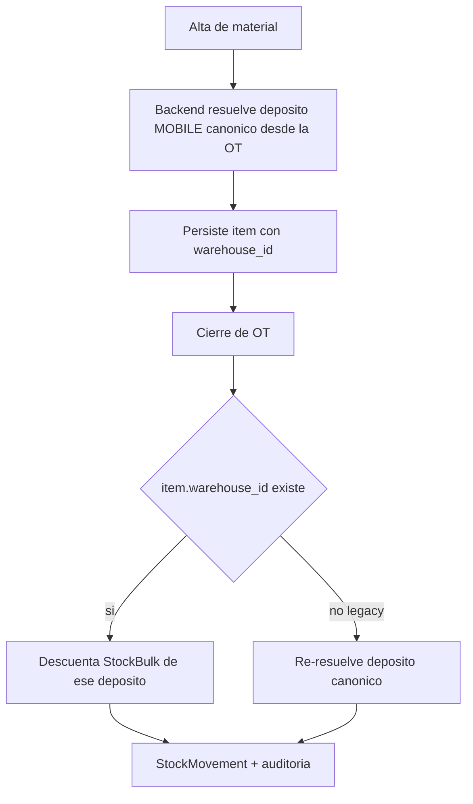
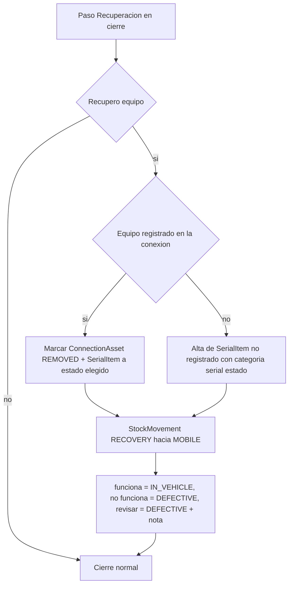

# Plan / Handoff — Corrección de inventario post-cierre y reapertura controlada de OT

> Documento de análisis y propuesta. **Estado: en análisis, no implementar aún.**
> Objetivo: retomar este tema sin volver a gastar en reconstruir contexto.

## 1. Contexto del problema

### 1.1 El incidente real (producción)

- Los técnicos **cierran OTs sin cargar los materiales consumidos**.
- Resultado: hay seriales (ej. **11 ONTs**) que figuran **"disponibles" en el móvil**
  cuando en realidad ya están **instalados en clientes**.
- Hoy la única salida es **rastrear manualmente por serial y corregir en DBeaver**
  (sin auditoría, riesgoso).
- Caso relacionado de **mala conexión**: el técnico cierra la OT y recién después
  puede corregir los materiales cuando recupera señal.

### 1.2 La tensión de diseño (planteada por el negocio)

- **Rigidez** → deja situaciones rotas (stock fantasma, seriales mal ubicados).
- **Edición libre de OT cerradas** → da lugar a manipulación descontrolada.
- Buscamos el punto medio: **corrección controlada y auditada**, no edición silenciosa.

## 2. Estado actual del sistema (referencias)

### 2.1 Inventario

| Concepto | Referencia |
|---|---|
| `SerialItem` (seriales y unidades trazables) | [`models/inventory.py`](../backend/src/models/inventory.py:432) |
| `SerialItemStatus` | [`models/inventory.py`](../backend/src/models/inventory.py:37) — `NEW`, `IN_VEHICLE`, `INSTALLED`, `DEFECTIVE`, `DAMAGED`, `DECOMMISSIONED`, `SOLD` |
| `StockBulk` (stock a granel por almacén) | [`models/inventory.py`](../backend/src/models/inventory.py:383) |
| `StockMovement` (auditoría de movimientos) | [`models/inventory.py`](../backend/src/models/inventory.py:523) |
| `MovementType` | [`models/inventory.py`](../backend/src/models/inventory.py:47) — `PURCHASE`, `TRANSFER`, `CONSUMPTION`, `RECOVERY`, `ADJUSTMENT`, `SALE`, `SALE_RETURN` |
| `ConsumptionLog` (consumo fraccionado) | [`models/inventory.py`](../backend/src/models/inventory.py:640) |
| `WarehouseType` | [`models/inventory.py`](../backend/src/models/inventory.py:23) — `CENTRAL`, `MOBILE`, `VIRTUAL`, `AUXILIAR` |

> Nota: los productos **compuestos** (cable, conectores, drop) se trackean como
> **unidades trazables** (`SerialItem` con `is_generated_barcode=true` y
> `remaining_quantity`), **no** como `StockBulk`. Ver [`barcode_generator_service.py`](../backend/src/services/barcode_generator_service.py:21).

### 2.2 Cierre de OT (efectos sobre inventario)

Endpoint: [`POST /work-orders/{id}/complete`](../backend/src/routers/work_orders.py:2035)
→ [`complete_work_order_with_inventory()`](../backend/src/services/wo_completion_service.py:57).

Al cerrar, cada `WorkOrderItem` se procesa así:

| Tipo de producto | Efecto | Referencia |
|---|---|---|
| BULK no compuesto | decrementa `StockBulk.quantity` en el móvil + `StockMovement(CONSUMPTION)` | [`_process_bulk_item`](../backend/src/services/wo_completion_service.py:276) |
| SERIALIZED | `SerialItem.status = INSTALLED`, lo mueve a warehouse `VIRTUAL`, setea `connection_id` y `ticket_related_id`, crea `ConnectionAsset` + `StockMovement(CONSUMPTION)` | [`_process_serialized_item`](../backend/src/services/wo_completion_service.py:347) |
| BULK compuesto (unidad trazable) | decrementa `remaining_quantity`, crea `ConsumptionLog`; si se agota → `INSTALLED` + mueve a virtual | [`_process_composite_tracked_serial_item`](../backend/src/services/wo_completion_service.py:426) |

**Consecuencia clave:** una reversa de cierre debe **deshacer** cada uno de esos
efectos (no basta con resetear el estado de la OT).

### 2.3 Reapertura de OT (ya existente, incompleta)

Endpoint: [`PUT /work-orders/{id}/reopen`](../backend/src/routers/work_orders.py:998).

Lo que hace hoy:
- Valida roles (admin/coordinator siempre; técnico asignado solo 2 h).
- Resetea `status = in_progress`, limpia `completed_at`, `resolution_type`,
  `resolution_notes`.
- Crea evento en timeline.

Lo que **NO** hace (gap):
- **No revierte el consumo de inventario** (no devuelve stock, no restaura seriales,
  no elimina `ConnectionAsset`).
- Tiene un **bug latente**: [`work_orders.py`](../backend/src/routers/work_orders.py:1050)
  usa `user_id` en vez de `current_user.id` para `is_assigned_technician` (solo
  estalla si no es admin).

### 2.4 Reapertura de tickets

Decidida en [`ADR-0001`](../docs/adr/ADR-0001-reapertura-tickets-y-rollback-instalacion.md:32):
botón "Reabrir" (PATCH status `open`), con timeline y auditoría. **No** reabre OTs
automáticamente.

### 2.5 Auditoría disponible

- [`audit_logs`](../backend/src/utils/audit.py): `log_create` / `log_update` / `log_delete`.
- `TicketTimeline` (eventos de ticket/OT).

## 3. Cómo lo manejan los sistemas carrier-class

Regla de oro: **los documentos contabilizados no se editan; se corrigen con
documentos de ajuste o reversa.**

1. **Reconciliación de inventario / stock adjustment:** para discrepancias físicas,
   se postea un movimiento de ajuste con **motivo obligatorio** y referencia al
   origen. La OT no se toca.
2. **Reversa de consumo (goods issue reversal):** si hay que corregir el consumo,
   se genera un movimiento inverso que revierte el efecto, dejando la OT original
   inmutable.
3. **Reopen controlado:** solo roles habilitados, con motivo y auditoría.

## 4. Parámetros que debe cumplir la solución

- **Trazabilidad total:** toda corrección queda en `audit_logs` + timeline.
- **Inmutabilidad del documento original:** no se edita una OT cerrada; se le
  agregan correcciones/reversas.
- **Roles acotados:** solo `admin`/`coordinator` para correcciones fuera de la
  ventana de gracia.
- **Motivo obligatorio** en toda corrección.
- **Operable sin SQL:** la corrección debe hacerse desde la UI.

## 5. Opciones analizadas

| Opción | Pros | Contras | Veredicto |
|---|---|---|---|
| Editar OTs cerradas libremente | rápido | destruye trazabilidad, manipulación | **descartado** |
| Reconciliación de inventario (ajuste de serial/stock) | resuelve stock sin tocar la OT; auditado | no deja rastro dentro de la OT | **recomendado (P1)** |
| **Bitácora de actualizaciones post-cierre (entradas append-only)** | corrige materiales/info/errores de cierre SIN reabrir; auditable, trazable, poco rígido | requiere tabla + endpoints + UI nuevos; no "reabre" la OT | **recomendado (P2) — idea del negocio** |
| Reapertura de OT con reversión de inventario | cubre "mala conexión" (cerrar → corregir → re-cerrar) | complejo y riesgoso (revertir BULK, serial, ConnectionAsset, ConsumptionLog) | **recomendado (P3), solo caso puntual** |
| Reporte de discrepancias | detección temprana | no corrige | **recomendado (P4)** |

## 6. Propuesta detallada

### P1 — Reconciliación de inventario (desbloquea hoy)

Nueva acción en Inventario (admin/coordinator):

- Para un `SerialItem`: cambiar `status` y `warehouse_id`, y setear `connection_id`
  (ej. `NEW` → `INSTALLED` en la conexión correcta).
- Para `StockBulk`: ajustar `quantity` (con signo).
- **Motivo obligatorio** + referencia libre.
- Genera `StockMovement(ADJUSTMENT)` y `log_update` en auditoría.

Con esto se corrigen los 11 ONTs sin tocar OTs/tickets.

### P2 — Bitácora de actualizaciones post-cierre (corrección sin reabrir)

Concepto: **no se reabre ni se edita la OT cerrada**; se le **agregan entradas de
bitácora** (append-only), como un libro de guardia. Cada entrada queda auditada y
visible, y puede (opcionalmente) aplicar un efecto de inventario.

- Nueva tabla `work_order_updates` (bitácora):
  `id`, `work_order_id`, `author_id`, `update_type`, `motive` (obligatorio),
  `payload` (JSONB), `created_at`.
- `update_type` sugerido (cubre tanto **agregar** como **editar** lo ya cargado,
  siempre como deltas append-only, nunca editando la línea original):
  - `MATERIALS_ADDED` — agregar material olvidado.
  - `MATERIALS_REMOVED` — quitar un material cargado por error (reversa de stock).
  - `MATERIALS_REPLACED` — reemplazar un material (compuesto por remove+add).
  - `MATERIALS_QTY_UPDATED` — corregir cantidad (delta con signo).
  - `INFO_CORRECTION` — datos/información que faltó o quedó mal.
  - `CLOSE_CORRECTION` — corregir el cierre (resolución, notas, fotos).
  - `NOTE` — aclaración libre.
- Endpoint `POST /work-orders/{id}/updates`:
  - Escribe la entrada en bitácora + evento en timeline + `audit_logs`.
  - Para los tipos de materiales, ejecuta el **ajuste de inventario** correspondiente
    (reusa P1) y lo **vincula** a la entrada (referencia `update_id` en el
    `StockMovement`), de modo que el stock quede corregido sin re-correr el cierre.

**Responsabilidad (evitar "admin paternalista"):** el **técnico es el dueño de su
corrección**. El flujo recomendado es self-service con revisión, no "admin limpia":

- **Corrección propia (ventana de gracia):** el técnico puede corregir su propia OT
  cerrada dentro de una ventana corta (ej. 2 h), incluyendo add/remove/replace/qty.
- **Corrección propia fuera de ventana:** el técnico la **propone** (bitácora en
  estado `PROPOSED`) y un `coordinator`/`tecnico_encargado` la **aprueba** antes de
  aplicar el efecto de inventario.
- **Corrección de terceros:** solo `admin`/`coordinator`/`tecnico_encargado` (de su
  cuadrilla), siempre con motivo.
- **Loop de aprendizaje:** reporte "cierres corregidos por cuadrilla/técnico" para
  que el error se haga visible y no se repita (el que se equivoca, corrige y queda
  registrado).

Ventaja: corrige los 3 casos (materiales, info, error de cierre) **sin el riesgo de
revertir** el cierre original; el documento original permanece inmutable y la
responsabilidad queda en quien operó.

### P3 — Completar el `reopen` de OT con reversión de inventario (solo mala conexión)

> **Actualización 2026-10-12:** superado por **P2 (bitácora)**. La corrección post-cierre
> se hace por bitácora **sin reabrir ni cambiar el estado de la OT** (el estado queda
> `completed`/`failed`). El `reopen` de estado se conserva únicamente como herramienta
> administrativa de emergencia, sin reversión automática de inventario en esta fase.

Al reabrir (roles ya definidos), además del reset de estado:

- **BULK:** devolver cantidad al `StockBulk` del móvil + movimiento de reversa.
- **SERIALIZED:** devolver `SerialItem` a `NEW`/`IN_VEHICLE`, restaurar warehouse
  original, limpiar `connection_id`/`ticket_related_id`, eliminar el `ConnectionAsset`
  + movimiento de reversa.
- **BULK compuesto (unidad trazable):** restaurar `remaining_quantity`, anular el
  `ConsumptionLog`, y revertir `INSTALLED`→ estado anterior si se había agotado.

Riesgos a mitigar: el `ConnectionAsset` puede estar referenciado en otros lados;
la reversa debe ser idempotente y transaccional.

### Reversión exacta y sin huella (regla del "camino de vuelta")

Cada corrección/rollback de material debe ser el **espejo exacto** del efecto del
cierre, en orden inverso, para no dejar residuos a nivel de datos:

- **Snapshot previo:** al cerrar, guardar en cada `StockMovement` (o en el
  `WorkOrderItem`) el **estado anterior** del item (`previous_status`,
  `previous_warehouse_id`, `previous_remaining_quantity`, `previous_quantity`).
  Sin esto es imposible revertir con exactitud.
- **SERIALIZED:** `INSTALLED → previous_status` (`NEW`/`IN_VEHICLE`), warehouse →
  `previous_warehouse_id` (vuelve al móvil), limpiar `connection_id`/`ticket_related_id`,
  anular/desactivar el `ConnectionAsset`, movimiento inverso.
- **BULK:** `StockBulk.quantity += cantidad` en el warehouse original.
- **BULK compuesto (unidad trazable):** `remaining_quantity += consumido`, anular el
  `ConsumptionLog`; si el item pasó a `INSTALLED`, revertirlo al estado previo y
  devolverlo a su warehouse original.
- **Transaccional + idempotente:** todo el rollback en una única transacción; si algo
  falla, nada se aplica. Un `idempotency_key` evita doble reversa ante reintentos.

Objetivo: a nivel auditoría quedan los movimientos nuevos; a nivel datos, el item
vuelve **exactamente** a su camino natural (domicilio→móvil, conectores repuestos,
metros de drop repuestos), sin estados fantasma.

### P4 — Reporte de discrepancias (detección temprana)

Reporte/query que detecte seriales que quedaron `NEW`/`IN_VEHICLE` en móviles
después de OTs cerradas (o seriales "disponibles" que ya deberían estar instalados).

## 7. Cierre transaccional y resiliencia a mala conexión (causa raíz)

El síntoma "OT vacía pese a haber seleccionado los materiales" suele ser **pérdida de
red a mitad del flujo**, no un error de negocio: los ítems se seleccionan en la UI pero
no llegan a persistirse antes del cierre. Cómo se resuelve en carrier-class/telecom:

1. **Guardar materiales primero, cerrar después** — separar "cargar ítems" de "cerrar":
   cada material se persiste (endpoint `POST /work-orders/{id}/items`) apenas se agrega,
   no se empaqueta todo en el cierre. El cierre solo transiciona estado y consume lo ya
   guardado.
2. **Idempotencia del cierre** — el cliente envía un `idempotency_key` (o
   `close_request_id` generado al abrir el wizard). Si la request se corta y se
   reintenta, el backend detecta la clave y **no duplica el consumo**.
3. **Outbox / cola local (offline-first)** — el frontend encola la operación
   (localStorage/IndexedDB) y reintenta con backoff cuando vuelve la señal; el estado
   queda "pendiente de sincronizar" y no se pierde.
4. **Detección de cierre inconsistente** — si una OT se cierra sin ítems y el técnico
   había iniciado la carga, marcar "cerrada sin materiales" y ofrecer el flujo P2
   (bitácora) para completarla, sin castigar al técnico (fue un problema de conexión).

Con esto, una mala conexión no rompe la OT: o se persiste todo, o queda pendiente de
reintento idempotente, o se detecta la inconsistencia para corregirla por la vía
auditada.

## 8. Preguntas abiertas (para analizar)

1. ¿La reconciliación (P1) debe permitir también **crear** el vínculo a una
   conexión (instalar el serial), o solo corregir estado/ubicación?
2. ¿La bitácora (P2) alcanza para cubrir todos los casos, o todavía hace falta
   P3 (reopen con reversión) para el caso "mala conexión"?
3. Para `MATERIALS_ADDED` en la bitácora: ¿qué granularidad? (¿se permiten
   seriales, bulk fraccionado, o ambos?) y ¿quién valida contra stock disponible?
4. ¿Qué pasa con el `ConnectionAsset` si una entrada de bitácora corrige/retira
   un serial ya instalado? (marcar inactivo vs borrar).
5. ¿Ventana de gracia para técnicos en la bitácora (P2), o solo
   `admin`/`coordinator`/`tecnico_encargado`?
6. ¿`update_type` y `motive` deben ser enums tipificados (más consistencia) o
   texto libre (más flexible)?
7. ¿Las entradas de bitácora se muestran como timeline de la OT, como pestaña
   propia, o ambas?

## 9. Notas de contexto de sesiones previas (para no perder el hilo)

- Se agregó la regla **"una sola tarea en curso por cuadrilla"** al iniciar OT:
  [`work_orders.py`](../backend/src/routers/work_orders.py:736). Si una cuadrilla ya
  tiene una OT `in_progress`, no puede iniciar otra (409).
- Bugs de logística ya resueltos en esta misma iteración (AUXILIAR como origen de
  entrega, transferencia BULK compuesto, `product_type` vs `type`, etc.).
- El módulo de Ventas (acción de stock) ya está implementado: `SALE`/`SALE_RETURN`
  y `SerialItemStatus.SOLD`.

## 10. Tickets administrativos y conexión física del activo

### 10.1 Causa raíz (confirmada en código)

En [`complete_work_order_with_inventory()`](../backend/src/services/wo_completion_service.py:57)
la conexión efectiva se resuelve **implícitamente** desde el ticket:

```python
connection_id = ticket.connection_id or ticket.destination_connection_id or ticket.origin_connection_id
```

y [`_process_serialized_item`](../backend/src/services/wo_completion_service.py:347)
crea el `ConnectionAsset` con ese `connection_id` (FK **NOT NULL** a
[`connections.connection_id`](../backend/src/models/inventory.py:896)).

Consecuencia:
- Ticket **administrativo** (TV, sin PPPoE) → `connection_id` es NULL → o bien el
  cierre falla con *"El ticket no tiene una conexión asociada"*, o se intenta crear un
  `ConnectionAsset` sin conexión.
- Si el técnico cambió una ONT en la **conexión real** (no la administrativa), el
  activo quedaría mal asociado (o no se puede guardar).

### 10.2 El problema de fondo: dos "conexiones" distintas

Hay dos conceptos mezclados en un solo campo:

- **Conexión de servicio** (cuenta/abonado): para qué se abrió el ticket (TV, plan, etc.).
- **Conexión física** (acceso): dónde se instaló/retiró el equipo (el ONT real).

En carrier-class/telecom esto se modela separado: el **documento de trabajo** se ata a
la cuenta, y el **activo** se ata a la conexión física donde efectivamente quedó.

### 10.3 Propuesta (sin romper ticket → conexión → OT)

1. **Permitir tickets "de servicio" sin conexión física:** `Ticket.connection_id` ya es
   nullable; solo falta que el cierre **no exija conexión** cuando la OT no tiene
   activos serializados. Si solo es un trámite (cambio de plan, TV), se completa sin
   tocar inventario.
2. **Nueva columna `WorkOrder.installation_connection_id`** (FK nullable): la "conexión
   física donde se aplicó el trabajo". Se setea **explícitamente** en el cierre, no se
   infiere por fallback.
3. **Selector explícito al cerrar (solo cuando aplica):** si la OT tiene ítems
   serializados y el ticket es `administrative`, o `connection_id` es NULL, o el
   técnico marca "trabajé en otra conexión", se muestra un **picker con las conexiones
   físicas del cliente** (de `connections` vía `clientes`):
   - 1 conexión → se preselecciona (visible, no silencioso).
   - N conexiones → el técnico elige.
   - Ninguna y hay activo → no se puede cerrar sin elegir (evita huérfano).
4. **`_process_serialized_item` usa `installation_connection_id ?? ticket.connection_id`**
   y el `ConnectionAsset` queda atado a la conexión física real.
5. **`ConnectionAsset.connection_id` sigue NOT NULL** (integridad), pero solo se crea
   cuando hay una conexión física válida; los ítems BULK/composite siguen sin requerir
   activo.

### 10.4 Por qué no "fallback a la conexión previa / preguntar si hay 2"

El fallback implícito es ambiguo y sí rompe la trazabilidad (nadie sabe con certeza en
qué conexión quedó el activo). En cambio, un **campo explícito + selector** mantiene:
- `ticket.connection_id` → contexto de servicio (intacto).
- `work_order.installation_connection_id` → ubicación física del activo (nuevo, claro).

Es una normalización, no un parche: separa "por qué se trabaja" de "dónde quedó el
equipo", que es exactamente lo que pide el caso de la ONT reemplazada en la conexión
real mientras el ticket era de TV.

### 10.5 El reemplazo de equipo es OTRO trabajo (swap), no parte de la OT administrativa

El caso puntual (ONT fallando, técnico la cambia en el domicilio) no es "información
olvidada": es un **trabajo de reemplazo de equipo** que apareció en campo y tiene su
propia semántica de inventario:

1. **Desvincular el SN viejo del cliente** (si estaba registrado): `ConnectionAsset`
   pasa a `REMOVED` (`removed_at`, `removed_by_wo_id`).
2. **Devolver el SN viejo al móvil**: `SerialItem` pasa de `INSTALLED` a `NEW`/`IN_VEHICLE`,
   `warehouse_id` → móvil, `connection_id` en NULL.
3. **Asignar el SN nuevo**: `SerialItem` → `INSTALLED` + nuevo `ConnectionAsset(INSTALLED)`.

Todo esto ya está soportado por el modelo actual ([`ConnectionAsset`](../backend/src/models/inventory.py:880)
tiene `INSTALLED`/`REMOVED`, y `SerialItem` tiene todo el ciclo de estados). No hace
falta una estructura nueva: hace falta **exponer el swap como operación de primer nivel**.

Cómo resolverlo sin parche:

- **A — OT de reemplazo creada en campo (recomendado).** El técnico, al detectar la ONT
  fallando, crea una **nueva OT de tipo "reemplazo de equipo"** sobre la **conexión
  física** (quick-create desde el móvil) y la completa con el swap. La OT administrativa
  (TV) se cierra aparte como "completada". El trabajo queda tipificado y sobre la conexión
  correcta; la estructura ticket → conexión → OT permanece intacta.
- **B — Swap dentro del cierre con confirmación explícita.** Si al cerrar una OT se está
  instalando un serial en una conexión que ya tiene un `ConnectionAsset(INSTALLED)` del
  mismo producto, el backend **detecta el reemplazo** y ejecuta el swap atómico
  (remover viejo + instalar nuevo), registrándolo como reemplazo. Permitido solo en OTs
  técnicas (no administrativas), con confirmación del técnico del serial que se retira.

En ambos casos el swap es una operación transaccional e idempotente (mismo criterio de
la §7): o se hace todo, o nada. La diferencia con "forzarlo en la OT de TV" es que el
reemplazo queda como **su propio hecho de trabajo**, con su propio rastro, sin ensuciar
el ticket administrativo ni inventar conexiones.

### 10.6 ¿OT anidada sin ticket, o ticket hermanado auto-creado?

Dato estructural: [`WorkOrder.ticket_id`](../backend/src/models/tickets.py:651) es
**NOT NULL**. Toda OT cuelga de un ticket, y todo ticket cuelga de una conexión. Por lo
tanto:

- **"OT anidada a la original sin ticket"** → rompe el invariante `ticket → conexión → OT`
  (FK violada). Descartado.
- **"Ticket hermanado auto-creado"** → el técnico, al detectar el problema, crea **en un
  solo paso** un **ticket técnico (tipo reemplazo de equipo) sobre la conexión física** y
  su OT correspondiente, de forma atómica. Esa OT ya no queda "huérfana": tiene su ticket
  y su conexión.

Vínculo con el origen: agregar `Ticket.parent_ticket_id` (self-FK nullable) para marcar
que este ticket "nació de" la OT administrativa. Es una relación **hermanada** (no
anidada), que conserva trazabilidad sin romper la jerarquía.

**Conclusión:** lo conveniente es **auto-crear el ticket** (no anidar la OT). Así:
- Se mantiene la regla `ticket → conexión → OT`.
- El trabajo queda tipificado (analytics, permisos, auditoría correctos).
- El swap (remover viejo + instalar nuevo) corre dentro de un ticket/OT legítimos, no como
  parche dentro de la OT de TV.

### 10.7 Solución primaria: el servicio de TV se referencia a una conexión existente

El planteo cierra el círculo y es más limpio: **TV es un servicio sobre una conexión
existente**, no una conexión nueva. Un cliente con 3 conexiones (3 domicilios) puede
tener TV solo en 2 → el servicio se asocia a las conexiones que correspondan.

Por lo tanto, la resolución de fondo es **en la creación del ticket**, no en el cierre:

1. **Nuevo tipo "Instalación TV" dentro de instalación** (o subtipo administrativo): NO
   demanda una conexión nueva, sino que **se une a la conexión existente** que recibe el
   servicio de TV.
2. **En la creación del ticket**, si el cliente tiene **más de una conexión**, el operador
   elige **a cuál conexión corresponde el servicio de TV** (picker de conexiones del
   cliente). Si tiene una sola, se preselecciona (visible).
3. Resultado: el ticket nace con el `connection_id` correcto (una conexión real, con
   PPPoE), de modo que:
   - Desaparece el "ticket administrativo sin conexión" y el error de guardado en el cierre.
   - Si el técnico reemplaza una ONT, lo hace **sobre la conexión correcta**, sin conflicto.
   - No hay que inventar conexiones ni forzar el swap dentro de otra OT.

Esto **no elimina** la necesidad del swap (remover viejo + instalar nuevo) cuando se
descubre un reemplazo en campo: ese sigue siendo un hecho de trabajo propio (§10.5/10.6).
Pero elimina la **causa** del conflicto: que el ticket apuntara a la conexión equivocada
(o a ninguna).

### 10.8 Flujo de creación de instalaciones (árbol de decisión) y organización de la UI

Al crear una instalación, el operador debe poder elegir **qué va a hacer**:

1. **Conexión nueva (aire / FTTH)** → flujo normal de instalación (crea conexión + cliente).
2. **Instalación Mesh** → seleccionar **sobre qué conexión existente** se hace → flujo mesh.
3. **Instalación de TV** → igual que Mesh: seleccionar **sobre qué conexión existente** se
   hace → flujo TV. (No crea conexión nueva.)

**Organización de la UI (recomendado):** mantener las **tarjetas top-level** del wizard
(cada una = un flujo de negocio) y agregar una **tarjeta "Instalación TV"** con su propio
`flow_key`, reutilizando el patrón de Mesh ("elegir conexión existente"). Motivo:

- Mesh ya es una tarjeta top-level; TV es estructuralmente igual, así que queda natural y
  consistente.
- No toca los flujos existentes (InstallationWizard queda intacto).
- Es más **descubrible e intuitivo** para el operador: piensa en "instalo TV" / "instalo
  Mesh" / "alta nueva", no en una sub-selección oculta dentro de "Instalación".

Backend: nuevo `TicketCategory.flow_key = "tv_installation"` (o `installation_type`
"TV" sobre `InstallationType`), reutilizando `connection_id`/`destination_connection_id`
como la **conexión existente objetivo**.

### 10.9 Swap "blando" y proceso retroactivo (best-effort)

El swap no debe ser binario (bloquear si no hay datos). Lógica sugerida:

- **Hay `ConnectionAsset(INSTALLED)` en la conexión** → swap completo: `REMOVED` + devolver
  el SN al móvil + instalar el nuevo.
- **No hay activo registrado** (hoy es lo común: < 1 mes de release y baja trazabilidad):
  - No fallar el cierre.
  - Pedir al técnico el **serial del equipo que se retira** (equipo de la empresa aún no
    registrado) y registrarlo como **retiro** (candidato a **baja**), instalando el nuevo.
  - Es recolección best-effort: si no se puede resolver el match, queda nota + pendiente.

**Proceso retroactivo (agendar):** vincular los seriales existentes a sus conexiones.
Riesgo detectado: **SmartOLT guarda seriales compuestos** (Huawei numérico → `HWT...` +
últimos dígitos), distinto al código de barras. Necesita una **capa de normalización de
seriales** (como ya existe [`normalize_scanned_code`](../backend/src/barcode_reader/normalization.py:1)
para el guion/apóstrofe) antes de intentar el match retroactivo; de lo contrario habrá
colisiones y falsos emparejamientos.

---

## 11. Fix estructural — Flujo de materiales (causa raíz confirmada)

### 11.1 Causa raíz

Confirmado con el mensaje real en pantalla: **"Stock insuficiente de X: disponible 0,
requerido N"**.

Aunque el agregado desde la interfaz de detalles y el agregado desde el wizard usan el
mismo hook [`useMaterialSelector.addMaterial()`](../frontend/src/components/work-orders/useMaterialSelector.js:297)
y el mismo endpoint [`add_work_order_item`](../backend/src/routers/work_orders.py:966), el
`warehouse_id` que envía el frontend **no existe** en [`WorkOrderItemCreate`](../backend/src/schemas/tickets.py:184)
y se descarta. Por lo tanto, al cierre, [`_process_bulk_item`](../backend/src/services/wo_completion_service.py:275)
**re-resuelve** el depósito con [`_get_work_order_warehouse_id`](../backend/src/services/wo_completion_service.py:542).

Esa re-resolución puede diferir del depósito que el frontend mostró/validó al cargar el
material:

- Frontend [`resolveWarehouse`](../frontend/src/components/work-orders/useMaterialSelector.js:117)
  prioriza `team_id`; si es `NULL` cae al team del **usuario logueado** (ej. un coordinador
  que precarga materiales).
- Backend prioriza `work_order.team_id`, luego `work_order.technician_id` (team del técnico
  de la OT) y recién después el usuario que cierra.

Resultado: el material se valida contra el depósito A (con stock) pero el cierre intenta
descontar del depósito B (sin stock) → error 422 y la OT no cierra. Al reingresar desde el
wizard en el dispositivo del técnico, ambas resoluciones coinciden y el cierre funciona. Es
**deriva de resolución de depósito**, no un formato distinto de item.

### 11.2 Fix en capas (sin hardcodeo)

1. **Persistir el origen.** Migración: columna `warehouse_id` (nullable, FK a `warehouses`)
   en [`WorkOrderItem`](../backend/src/models/tickets.py:867). El item queda con su depósito
   de origen registrado para auditoría y rollback exacto (§7 "camino de vuelta").
2. **Resolver en backend, no confiar en el frontend.** [`add_work_order_item`](../backend/src/routers/work_orders.py:966)
   calcula el depósito canónico con la **misma** función del cierre
   [`_get_work_order_warehouse_id`](../backend/src/services/wo_completion_service.py:542)
   (aplicada al `wo`) y lo persiste. Si el frontend envía un `warehouse_id` distinto, se
   responde 422 explícito para visibilizar la deriva en lugar de descartarla en silencio.
3. **Descontar del origen persistido.** [`_process_bulk_item`](../backend/src/services/wo_completion_service.py:275)
   usa `item.warehouse_id` como fuente autoritativa; solo si es `NULL` (filas legacy)
   re-resuelve como hoy.
4. **Alinear el fallback del frontend.** [`resolveWarehouse`](../frontend/src/components/work-orders/useMaterialSelector.js:117)
   debe espejar el backend: si no hay `team_id` pero sí `technician_id`, resolver por el team
   del técnico de la OT (pasar `technicianId` al hook), y solo después caer al usuario actual.
5. **Anti-duplicados de serial.** [`add_work_order_item`](../backend/src/routers/work_orders.py:966)
   rechaza agregar un `serial_number` que ya existe en la misma OT (productos SERIALIZED),
   evitando el fallo "ya está instalado en otra conexión" por duplicados.

### 11.3 Invariante

**Una única función canónica de resolución de depósito, usada en alta y en cierre, cuyo
resultado se persiste en el item.** Así el descuento siempre coincide con el depósito que
mostró stock, y el rollback puede devolver exactamente al mismo lugar.



---

## 12. Flujo de recuperación de equipos del domicilio

### 12.1 Objetivo y estados

Registrar qué equipos de la empresa se recuperaron del domicilio y en qué estado. Tres
estados, mapeados al enum existente [`SerialItemStatus`](../backend/src/models/inventory.py:37):

| Estado en UI | SerialItemStatus | Warehouse destino | ConnectionAsset |
|---|---|---|---|
| **Funciona** | `IN_VEHICLE` | MOBILE del técnico (vuelve a stock) | `REMOVED` |
| **No funciona** | `DEFECTIVE` | MOBILE (candidato a baja) | `REMOVED` |
| **Revisar** | `DEFECTIVE` + nota | MOBILE (pendiente evaluación central) | `REMOVED` |

El [`MovementType.RECOVERY`](../backend/src/models/inventory.py:53) ya existe para registrar
la trazabilidad del movimiento.

### 12.2 Barrido lógico — qué tickets llevan el paso

No se agrega un paso obligatorio a todos los tickets. Se muestra **solo** cuando hay visita
física y retiro plausible, y es **salteable** (default "No recuperé equipos"):

- **SÍ** — `technical`, `relocation`, `withdrawal`, `fiber_migration`, `mesh`, e `Instalación TV`
  (tvbox) cuando exista.
- **NO** — `installation` nueva (domicilio sin equipo previo) y `administrative`.

Se implementa como un **paso opcional del wizard de cierre** (o sección plegable), no como
wizard nuevo, para no friccionar al técnico.

### 12.3 UI del paso (intuitiva para técnicos rústicos)

1. Pregunta binaria: **"¿Recuperaste algún equipo del domicilio?"** → `Sí` / `No`.
2. Si `Sí`:
   - Combo **"Equipos que estaban en el domicilio"**: precargado con los
     `ConnectionAsset(INSTALLED)` de la conexión (routers, mesh, antenas, tvbox, ONT).
   - Debajo, opción **"Agregar equipo no registrado"**: elegir categoría
     (router / mesh / antena / tvbox / ONT) + serial libre + estado.
   - Por cada equipo: selector de estado **Funciona / No funciona / Revisar**.
3. Botón confirmar. Un solo botón, sin jerga.

### 12.4 Backend

Nuevo endpoint `POST /v2/work-orders/{id}/recovery` (idempotente) o sección del payload de
cierre. Por cada equipo recuperado:

- **Registrado** (`ConnectionAsset`): marcar `REMOVED` + `removed_by_wo_id`; `SerialItem`
  → estado según la tabla + `warehouse_id` MOBILE del técnico; `StockMovement(RECOVERY)`.
- **No registrado**: crear `SerialItem` con serial/categoría/estado (funciona → `IN_VEHICLE`,
  no funciona → `DEFECTIVE`, revisar → `DEFECTIVE` + nota) + `StockMovement(RECOVERY)`.
  Es la misma recolección best-effort del swap blando (§10.9), aplicada al retiro sin match.



---

## 13. Estado de implementación y roadmap de fases

> Actualizado 2026-10-12. Cada fase es pequeña y entregable para prueba
> (no se avanza a la siguiente sin validar la anterior).

### 13.1 Implementado (Code)

- **§11 Fix flujo de materiales** — `warehouse_id` persistido en `work_order_items`,
  resolución canónica del depósito en alta y cierre, anti-duplicados de serial, frontend
  alineado. ✅
- **§12 Recuperación de equipos del domicilio** — 3 estados, endpoint idempotente
  `POST /work-orders/{id}/recovery`, paso opcional en el cierre. ✅
- **P2 manipulación total de materiales (corrección real)** — migración `009` agrega
  snapshot de reversa (`previous_serial_status`, `previous_warehouse_id`,
  `previous_remaining_quantity`) a `work_order_items`; el cierre captura el estado previo
  y la bitácora revierte de forma exacta (`reverse_material_item`): `MATERIALS_REMOVED`
  (quitar + reversa), `MATERIALS_QTY_UPDATED` (reversa + reproceso con nueva cantidad) y
  `MATERIALS_REPLACED` (quitar erróneo + agregar correcto). El serial vuelve al móvil, el
  `ConnectionAsset` se marca `REMOVED`, el BULK se reacredita y la bobina recupera saldo. ✅

### 13.2 Roadmap restante

| Fase | Alcance | Verificación de salida |
|---|---|---|
| **F0** | Aplicar migración `warehouse_id`, rebuild de contenedores, smoke test §11/§12 | Cierre con material precargado no da "Stock insuficiente"; recovery registra equipos |
| **F1 — P1** | Reconciliación: ajuste de `SerialItem` (status/warehouse/connection) + corrección negativa de `StockBulk` + motivo obligatorio + `ADJUSTMENT` | Admin/coordinator corrige los 11 ONTs sin SQL |
| **F2 — P2** | Bitácora post-cierre: tabla `work_order_updates`, endpoint, tab en OT, modelo PROPOSED/APPROVED | Correcciones append-only auditadas |
| ~~F3 — P3~~ | ~~Reopen con reversión~~ — superado por F2 (la bitácora corrige sin reabrir ni cambiar estado) | — |
| **F4 — P4** | Reporte de discrepancias (seriales "disponibles" tras cierre) | Query/UI detecta fantasmas |
| **F5 — §7** | Cierre idempotente (`idempotency_key`) + detección "cerrada sin materiales" | Reintento no duplica consumo |
| **F6 — §10.7/10.8** | Instalación TV: `InstallationType` + `flow_key` + tarjeta top-level + picker de conexión en creación | Ticket TV nace con conexión correcta |
| **F7 — §10.3/10.6/10.9** | `installation_connection_id` + picker al cierre, swap blando, `parent_ticket_id` + quick-create, normalización SmartOLT (retroactivo) | Reemplazo en campo tipificado y trazable |

### 13.3 Decisiones por defecto (preguntas abiertas §8)

1. **P2 ventana de gracia:** el **mismo día calendario local** (America/Argentina/Buenos_Aires)
   para el técnico sobre su propia OT; fuera de ventana → `PROPOSED` con aprobación de
   `coordinator`/`tecnico_encargado`.
2. **P2 granularidad:** `MATERIALS_ADDED` admite seriales y bulk fraccionado (reusa el
   selector de materiales + validación contra stock).
3. **P2 `update_type`/`motive`:** `update_type` enum tipificado; `motive` texto libre
   obligatorio (mín. 10 caracteres).
4. **P2 display:** tab propia en el detalle de OT + evento en timeline (ambas).
5. **Corrección de activo instalado:** marcar `ConnectionAsset` `REMOVED` (nunca borrar).
6. **P3 idempotencia:** `idempotency_key` en reopen para evitar doble reversa.
7. **§7 offline outbox:** queda como fase opcional posterior; en F5 se hace la parte
   servidor (idempotencia + detección), no la cola offline completa del frontend.
