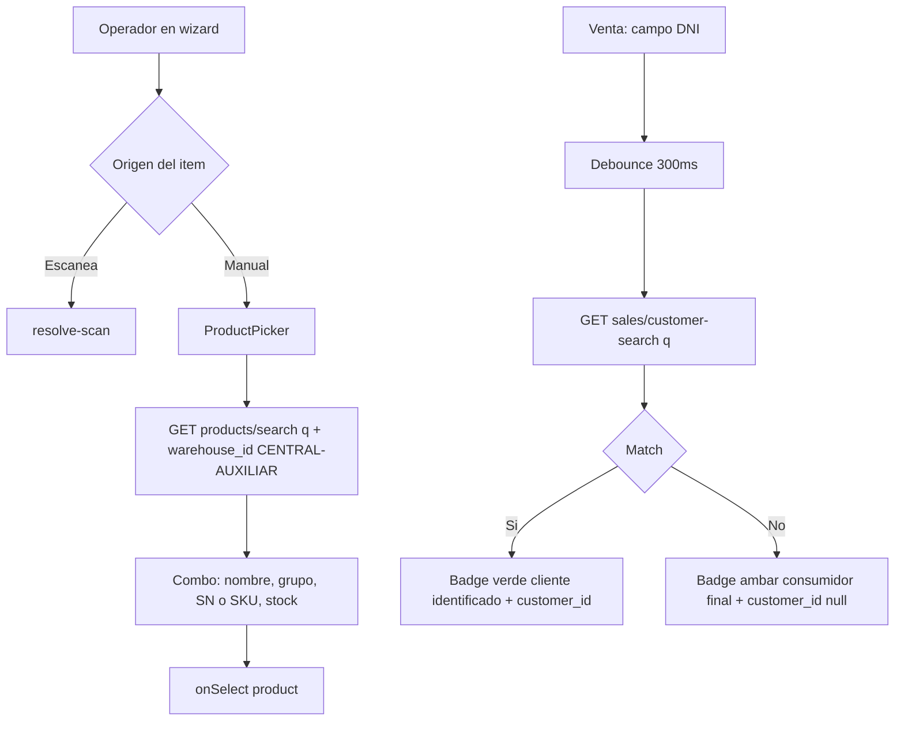

# Plan — Mejoras al módulo de Logística (6 frentes)

> Estado: **propuesta en análisis** (no implementar todavía).
> Objetivo: proyecto en etapas bien definidas, priorizando robustez y estructura profesional,
> para retomarlo sin reconstruir contexto.

## 0. Reglas de oro

1. **No romper nada de lo que ya funciona.** Los cambios nuevos se agregan como endpoints
   y componentes nuevos; no se reescriben flujos probados.
2. **Reutilizar antes que duplicar.** Antes de crear cada endpoint/componente, auditar si ya
   existe algo testeado (ver tabla en §1.2). Solo se crea lo que no existe o no cubre el caso.

## 1. Resumen de los 6 frentes y decisiones ya definidas

| # | Frente | Decisión confirmada |
|---|--------|---------------------|
| 1 | Búsqueda/combo de productos (entrega + venta) | Solo depósitos **CENTRAL/AUXILIAR** (no móviles). Mostrar **SN primero, SKU como fallback**. |
| 2 | Compra de compuestos: identidad individual siempre | Crear `SerialItem` siempre en compra de compuestos; el flag deja de decidir la identidad. |
| 3 | Prefijo de código coherente | `barcode_prefix` en la **creación/edición del producto** (no en la compra). |
| 4 | Reimpresión múltiple de etiquetas | Página nueva **dentro del módulo de logística** o **modal** (lo que resulte más eficiente). |
| 5 | DNI dinámico en ventas | FK a `clientes.id` permitiendo **null** + snapshot dni/nombre. |
| 6 | Click en Explorador → detalle | Drawer/modal con stock, seriales e historial. |

### 1.1 Aclaración sobre depósitos (frente 1)

Los flujos de **entrega de materiales a cuadrillas** y **venta al público** trabajan con
almacenes **CENTRAL** y **AUXILIAR**. El `ProductPicker` nunca debe filtrar ni sugerir
depósitos **MOBILE**: entregar algo que ya está en un móvil no es flujo normal de trabajo.

### 1.2 Auditoría de endpoints existentes (hacer en cada etapa)

| Necesidad | ¿Existe hoy? | Reusar / Crear |
|-----------|--------------|----------------|
| Buscar productos por nombre/SKU | [`GET /v2/inventory/products`](../backend/src/routers/inventory.py:621) (`search`, `group_id`, `type`, `category`) | Reusar patrón ILIKE; falta búsqueda por **grupo** y **SN** → se extiende o se agrega endpoint liviano |
| Stock agregado por warehouse | [`GET /v2/inventory/products/analytics`](../backend/src/routers/inventory.py:701) | Referencia para cálculo de `available_in_warehouse` |
| Resolver un código escaneado (SKU/SN → producto) | [`GET /v2/inventory/resolve-scan`](../backend/src/routers/inventory.py:2131) | **Reusar tal cual** en el picker/scan |
| Listar unidades trazables para reimprimir | [`GET /v2/logistics/tracked-units/labels`](../backend/src/routers/logistics.py:1046) (solo por ids) | Falta listado filtrable → endpoint nuevo |
| PDF de etiquetas | [`GET /v2/logistics/tracked-units/labels.pdf`](../backend/src/routers/logistics.py:1089) | **Reusar tal cual** |
| Buscar cliente por nombre/DNI | [`GET /v2/tickets/search-connections`](../backend/src/routers/tickets.py:312) y [`/external/customer-lookup`](../backend/src/routers/search.py:102) | Reusar patrón ILIKE para `clientes`; crear `customer-search` solo si `search-connections` no cubre "cliente sin conexión" |

## 2. Etapas propuestas

### Etapa 1 — Fundaciones: búsqueda de productos + identidad de compra + prefijo

**1.1 Product search + componente `ProductPicker`**
- Backend (auditar primero): endpoint liviano de búsqueda de productos:
  - `q` matchea `name ILIKE` **OR** `group.name ILIKE` **OR** `serial_items.serial_number ILIKE`
    **OR** `sku ILIKE`.
  - `warehouse_id` (opcional, siempre CENTRAL/AUXILIAR en estos flujos) → calcula
    `available_in_warehouse` (bulk + seriales NEW/IN_VEHICLE en ese depósito).
  - Respuesta: `{ id, name, sku, type, is_composite, category, group_id, group_name,
    unit_measure, composite_unit_label, unit_size, available_in_warehouse,
    barcode_label, has_serial }`.
  - `barcode_label`: **SN** si el producto/coincidencia tiene serial (preferir el SN que
    matcheó o el primero disponible en el depósito); si no, **SKU**.
- Frontend: componente reutilizable `ProductPicker` (modal o combo inline):
  - Debounce (300 ms), mínimo 2 caracteres.
  - Resultado: **nombre**, **grupo/categoría**, **código de barras (SN o SKU)**.
  - Navegación por teclado (↑/↓/Enter/Escape) y click. Callback `onSelect(product)`.

**1.2 Compra de compuestos: identidad individual siempre**
- Backend en [`create_stock_adjustment`](../backend/src/routers/inventory.py:1444):
  - Si `product.is_composite` y `movement_type == PURCHASE` → **siempre** generar
    `SerialItem` vía [`generate_batch`](../backend/src/services/barcode_generator_service.py:77),
    sin depender del flag `generate_barcodes`.
  - `generate_barcodes` se conserva en el payload por compatibilidad pero ya no decide la
    creación de identidad.
  - BULK **no compuestos** (granel continuo) siguen sumando a `StockBulk` (sin identidad).
  - `quantity` debe seguir siendo entero para compuestos.
- Frontend en [`StockAdjustments.jsx`](../frontend/src/pages/inventory/StockAdjustments.jsx:807):
  - Reemplazar checkbox por texto informativo: *"Los compuestos se registran como unidades
    trazables con identidad propia; las etiquetas se imprimen después."*
- Opcional (documentar): script de remediación para compuestos legacy sin `SerialItem`.

**1.3 Prefijo de código coherente**
- Backend:
  - Columna `products.barcode_prefix` (`String(4)`, nullable) + migración Alembic.
  - [`_infer_prefix`](../backend/src/services/barcode_generator_service.py:24):
    1. `product.barcode_prefix` si está seteado.
    2. Derivar de `group.name` normalizado (ONT/ONU→`ONT`, ROUTER→`RTR`, CABLE→`CBL`,
       CONECTOR→`CNT`, DROP→`DRP`, FIBRA→`FBR`).
    3. Fallback: primeras 3 letras del `sku` en mayúsculas (no más `TRK` fijo).
  - Backfill de productos existentes.
- Frontend: campo "Prefijo de código" en la **creación/edición** de producto
  ([`ProductCatalog.jsx`](../frontend/src/pages/inventory/ProductCatalog.jsx)),
  validación 1–4 caracteres alfanuméricos.

### Etapa 2 — Integrar `ProductPicker` en los wizards (frente 1)

- [`MaterialDeliveryWizard.jsx`](../frontend/src/pages/logistics/MaterialDeliveryWizard.jsx):
  - Paso 2 ("Agregar producto manualmente"): cada fila manual elige producto con
    `ProductPicker` (hoy la fila queda con `product_id` vacío y sin selector).
  - Depósito de contexto: el origen seleccionado (CENTRAL/AUXILIAR).
- [`SaleWizard.jsx`](../frontend/src/pages/sales/SaleWizard.jsx:242):
  - Reemplazar `<select>` plano por `ProductPicker`, usando `warehouseId` (CENTRAL/AUXILIAR)
    como filtro y mostrando stock disponible.
- Fuera de alcance (documentar en Etapa 6): Compras/Ajustes y Recepciones.

### Etapa 3 — Reimpresión múltiple de etiquetas (frente 4)

- Backend: nuevo `GET /v2/logistics/tracked-units` (unidades trazables `is_generated_barcode=true`):
  - Filtros: `q` (SN o nombre/SKU de producto), `product_id`, `warehouse_id`, `status`,
    `limit/offset`.
  - Respuesta: `{ serial_item_id, serial_number, product_name, product_sku, status,
    warehouse_name, created_at }`.
- Frontend: nueva página **en el módulo de logística** (o modal, según resulte más
  eficiente) con tabla de unidades trazables y selección múltiple:
  - Click toggles; **Ctrl+click** suma/resta; **Shift+click** rango; **Ctrl+A** selecciona
    lo visible; checkbox cabecera "seleccionar todo (filtrado)".
  - Botón "Imprimir seleccionados (N)" → reutiliza
    [`/v2/logistics/tracked-units/labels.pdf`](../backend/src/routers/logistics.py:1089).
  - Mantener el flujo actual por URL ("imprimir ahora" / "último lote") sin tocarlo.

### Etapa 4 — DNI dinámico en ventas (frente 5)

- Modelo + migración:
  - `Sale` gana `customer_id` (FK a `clientes.id`, **nullable**), `customer_dni` y
    `customer_name` (snapshot). Ver [`Cliente`](../backend/src/models/beholder.py:83)
    (`doc_number` = DNI).
  - [`SaleCreate`](../backend/src/schemas/sales.py:24) acepta `customer_id` opcional.
  - `SaleResponse` expone `customer_id`, `customer_dni`, `customer_name`.
- Backend:
  - `GET /v2/sales/customer-search?q=` → `clientes` con `name ILIKE` **OR**
    `doc_number ILIKE` (mismo patrón que [`search-connections`](../backend/src/routers/tickets.py:312)),
    devolviendo `{ id, name, doc_number, address }`. Auditar si `search-connections` ya
    cubre el caso; si un cliente no tiene conexión, se necesita este endpoint dedicado.
  - [`sales_service.create_sale`](../backend/src/services/sales_service.py) guarda el vínculo
    (`customer_id`) y snapshottea dni/nombre.
- Frontend en [`SaleWizard.jsx`](../frontend/src/pages/sales/SaleWizard.jsx:208):
  - Campo "DNI/CUIT del comprador" dinámico: debounce + `customer-search`.
  - Combo con coincidencias (nombre + DNI + dirección) para ligar `customer_id`.
  - Match → badge verde "Cliente identificado".
  - Sin match → `customer_id=null`, badge ámbar "Consumidor final / no registrado" y warning
    "DNI sin coincidencias: verificá los dígitos" (distingue no-cliente de dato mal tipeado).
    El DNI se conserva como referencia aunque no ligue.

### Etapa 5 — Detalle de producto en Explorador (frente 6)

- Backend: nuevo `GET /v2/inventory/products/{product_id}/detail`:
  - Info general (name, sku, type, category, group, unit info, spec, min_stock).
  - Resumen de stock (bulk + serial por estado).
  - Lista de `SerialItem` (serial, estado, warehouse, fechas, connection_id).
  - Historial de `StockMovement` (fecha, tipo, origen/destino, cantidad, serial, referencia,
    usuario). **Fecha de compra** = primer movimiento `PURCHASE` (`MIN(date)`).
  - Auditar: `list_stock_movements` ([`GET /v2/inventory/movements`](../backend/src/routers/inventory.py:1377))
    ya existe y puede reutilizarse filtrando por `product_id`; solo se agrega el agregado
    "detalle de producto" si no está cubierto.
- Frontend en [`ProductExplorer.jsx`](../frontend/src/pages/inventory/ProductExplorer.jsx:307):
  - Filas clickeables → drawer/modal con secciones: general, stock por estado, seriales,
    historial (paginado).

### Etapa 6 — QA, despliegue y documentación

- Pruebas manuales por frente (sin romper flujos existentes: entrega, transferencia, venta,
  cierre de OT, impresión).
- Aplicar migraciones (`alembic upgrade head`), restart backend y rebuild frontend.
- Documentar pendientes explícitos: **ProductPicker en Compras/Ajustes y Recepciones queda
  para una iteración futura** (anotar en docs para no perder el hilo).

## 3. Diagrama de flujo (frentes 1 y 5)

## 4. Notas de contexto previo (para no perder el hilo)

- Ya resueltos en iteraciones anteriores: AUXILIAR como origen de entrega, transferencia
  BULK compuesto, `product_type` vs `type`, `create_delivery` CENTRAL→AUXILIAR, una OT en
  curso por cuadrilla, impresión 1:1 de códigos (PNG/PDF).
- Los productos compuestos se trackean como unidades trazables; el cierre de OT los consume
  vía [`_process_composite_tracked_serial_item`](../backend/src/services/wo_completion_service.py:426).
- El módulo Ventas es MVP de acción de stock (SALE/SALE_RETURN, `SOLD`).

## 5. Estado de implementación (sesión 2026-10-09)

Implementado y desplegado en **dev**:

- **Etapa 1.1** — `GET /v2/inventory/products/search` (nombre/grupo/SN/SKU + disponibilidad por
  depósito) y componente [`ProductPicker.jsx`](../frontend/src/components/inventory/ProductPicker.jsx:1).
- **Etapa 1.2** — [`create_stock_adjustment`](../backend/src/routers/inventory.py:1544) crea
  `SerialItem` siempre para compuestos comprados; el flag `generate_barcodes` ya no decide identidad.
- **Etapa 1.3** — `products.barcode_prefix` (modelo, schema, migración
  [`2026_10_09_001`](../backend/alembic/versions/2026_10_09_001_add_product_barcode_prefix.py:1)),
  `_infer_prefix` coherente y campo editable en [`ProductCatalog.jsx`](../frontend/src/pages/inventory/ProductCatalog.jsx:1).
- **Etapa 2** — `ProductPicker` integrado en [`MaterialDeliveryWizard.jsx`](../frontend/src/pages/logistics/MaterialDeliveryWizard.jsx:1)
  (paso 3, ingreso libre sin propuesta, reutilizando `resolveScan`) y en
  [`SaleWizard.jsx`](../frontend/src/pages/sales/SaleWizard.jsx:1).
- **Etapa 3** — `GET /v2/logistics/tracked-units` + página
  [`TrackedUnitsReprint.jsx`](../frontend/src/pages/logistics/TrackedUnitsReprint.jsx:1) con
  selección múltiple (click/Ctrl/Shift/seleccionar todo) y PDF reutilizado. Acceso desde
  [`StockAdjustments.jsx`](../frontend/src/pages/inventory/StockAdjustments.jsx:1) ("Reimprimir etiquetas").
- **Etapa 4** — `sales.customer_id` (FK `clientes`, null) + snapshots `customer_dni`/`customer_name`
  (migración [`2026_10_09_002`](../backend/alembic/versions/2026_10_09_002_add_sale_customer.py:1)),
  `GET /v2/sales/customer-search` y campo DNI dinámico en `SaleWizard`.
- **Etapa 5** — `GET /v2/inventory/products/{id}/detail` + filas clickeables y modal de detalle en
  [`ProductExplorer.jsx`](../frontend/src/pages/inventory/ProductExplorer.jsx:1).

**Pendiente documentado (próxima iteración):** extender `ProductPicker` a
Compras/Ajustes ([`StockAdjustments.jsx`](../frontend/src/pages/inventory/StockAdjustments.jsx:1)) y a
Recepciones ([`MaterialReceiptWizard.jsx`](../frontend/src/pages/logistics/MaterialReceiptWizard.jsx:1)).
