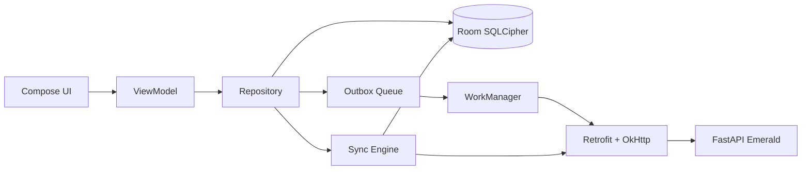

# 01 — Especificación de la App Android para Técnicos de OT

## 1. Visión

App Android nativa, offline-first, que replica el rol del técnico del módulo de OT de Emerald y evoluciona hacia funciones avanzadas (configuración automática de equipos, OCR, firma digital). La web de Emerald se mantiene como fallback.

**Pilares:** robustez nativa, operación sin señal, sincronización confiable, estética coherente con Emerald (cyberpunk retro neon) y apertura para crecer.

## 2. Alcance funcional

### 2.1 Paridad con la vista web del técnico

| Módulo | Funcionalidad | Origen web |
|--------|---------------|------------|
| Auth | Login, refresh, logout, sesión persistente cifrada | [`auth.py`](backend/src/routers/v1/auth.py:47) |
| Agenda | Listado de OTs del día agrupado por turno | [`WorkOrdersPage.jsx`](frontend/src/pages/WorkOrdersPage.jsx:133) |
| Listado | Filtros server-side (status, tipo, búsqueda, cuadrilla), paginado | [`list_work_orders`](backend/src/routers/work_orders.py:139) |
| Detalle | Cliente, DNI, teléfono, dirección, mapa, PPPoE/plan/nodo/VLAN | [`WorkOrderExecutionPage.jsx`](frontend/src/pages/WorkOrderExecutionPage.jsx:136) |
| Ejecución | Iniciar, cancelar inicio, pausar, timer | [`update_work_order`](backend/src/routers/work_orders.py:672) |
| Cierre | Wizard: acción de resolución + narrativa, materiales, fotos | [`CloseWorkOrderDialog.jsx`](frontend/src/components/work-orders/CloseWorkOrderDialog.jsx:30) |
| Materiales | Escáner de código de barras/serial, bulk vs. serializado | [`useMaterialSelector`](frontend/src/components/work-orders/useMaterialSelector.js) |
| Fotos | Captura/adjunto con compresión, upload a MinIO | [`tickets_v2_attachment.py`](backend/src/routers/tickets_v2_attachment.py:48) |
| Equipos | Recuperación de equipos (retiro) | `POST /{id}/recovery` |
| Conexión | Notas de conexión y activos instalados/retirados | [`connection-notes`](backend/src/routers/work_orders.py:3384) |
| Contacto | Intentos de contacto | `POST /{id}/contact-attempts` |
| Bloqueos | OT vencida (`pending_closure`) e inspección diaria de vehículo | [`get_my_pending_closure`](backend/src/routers/work_orders.py:353) |
| Diagnóstico | Diagnóstico remoto Beholder (PPPoE, señal óptica) | [`beholder.service.js`](frontend/src/services/beholder.service.js:30) |

### 2.2 Funcionalidades nuevas propias de la app

1. **Notificaciones push** (FCM): nueva OT asignada, cambios de estado, recordatorios de OT vencida, avisos de coordinación.
2. **Notificaciones locales offline**: timer en curso, OT por vencer, pendientes de cierre.
3. **Mapas GPS sin conexión**: descarga previa de la zona donde se ubica la OT, navegación, posición del técnico.
4. **Modo avión/sin señal**: operación completa de lectura y escritura; sincronización posterior.
5. **Cámara + escáner integrados**: captura de fotos con compresión y escaneo de seriales/códigos con ML Kit o DataWedge.
6. **Firma digital del cliente** (futuro), **OCR de DNI** (futuro), **configuración automática de equipos** (futuro).

## 3. Estética — Cyberpunk Retro Neon (coherente con Emerald)

Se replica el design system del frontend web (Tailwind dark mode).

### 3.1 Paleta base

| Token | Valor | Uso |
|-------|-------|-----|
| Fondo principal | `zinc-950` (#09090b) | Pantallas |
| Superficie | `zinc-900/50`, `zinc-800/50` | Cards y paneles |
| Borde | `zinc-800`, `zinc-700` | Delimitadores |
| Texto primario | `white` / `zinc-200` | Títulos y datos |
| Texto secundario | `zinc-400` / `zinc-500` | Labels |
| Acento primario (neón) | `emerald-400` (#34d399) / `emerald-300` | Acciones, foco, éxito |
| Acento peligro | `rose-400/300` | Errores, cancelaciones |
| Acento advertencia | `amber-400/300` | Vencidas, avisos |
| Acentos de tipo OT | `blue-400`, `sky-400`, `purple-400` | Instalación, infra, interno |

### 3.2 Tipografía

- Sans para UI (Roboto/Inter), **monoespaciada** para datos técnicos: PPPoE, DNI, timer, IP, seriales (equivalente a `font-mono`).

### 3.3 Componentes y estilos

- **Badges de estado** con fondo translúcido (`/10`–`/15`) y borde (`/30`–`/50`) — ej. `bg-emerald-500/10 border-emerald-500/30 text-emerald-300`.
- **Efecto neón** en hover/foco: sombra `rgba(52,211,153,0.5)` (emerald), `rgba(251,191,36,0.3)` (amber).
- **Timer** del trabajo en curso con tipografía mono y fondo `emerald-950/30`.
- **Tarjetas** con bordes finos y esquinas `rounded-lg`.
- **Iconografía**: equivalente Material Symbols a los iconos Lucide usados en web (`Wrench`, `Home`, `Package`, `Zap`, `MapPin`, `Phone`, `Wifi`, `Clock`, `Play`, `CheckCircle2`, `AlertCircle`).
- **Modo oscuro exclusivo** (no hay tema claro), fiel a Emerald.

## 4. Seguridad

1. **Transporte:** HTTPS obligatorio + **certificate pinning** en producción.
2. **Tokens:** almacenados en Android Keystore / EncryptedSharedPreferences, nunca en texto plano ni logs.
3. **Datos en reposo:** Room con SQLCipher (o equivalentes) para cifrar OTs, fotos pendientes y PII.
4. **Integridad del dispositivo:** Play Integrity API (opcional) para detectar root/emulador; bloqueo de pantalla (biométrico/PIN) para abrir la app.
5. **Sesión:** expiración de access token + refresh rotation; cierre de sesión remoto revocable.
6. **PII:** no loguear DNI, teléfonos ni direcciones; redacción en logs y crash reports.
7. **Retención/borrado:** política de purga de datos offline (por ejemplo, 30 días) y borrado remoto ante robo.
8. **Fotos:** compresión local antes de subir; solo se envían por canal autenticado a MinIO vía backend o presigned URL.

## 5. Autenticación

- Login contra `POST /api/v1/auth/login` (OAuth2 password grant, `application/x-www-form-urlencoded`), mismo endpoint que la web.
- Respuesta: `access_token` + `refresh_token` + `expires_in`.
- Refresh contra `POST /api/v1/auth/refresh`; interceptor de red reintenta una vez ante 401.
- Perfil y capabilities vía `GET /api/v1/auth/me` (usa [`build_capabilities`](backend/src/core/security.py:395)).
- **Pendiente de backend:** token de dispositivo revocable o refresh de larga duración para móvil (ver doc 03).

## 6. Manejo offline

Principios:

1. **Room es la fuente de verdad local.** La UI nunca espera a la red.
2. **Escrituras optimistas:** iniciar, completar, materiales y fotos se guardan localmente con estado `pending` y `idempotency_key`; WorkManager las despacha con `NetworkType.CONNECTED` y backoff exponencial.
3. **Sync de lectura:** al iniciar la app (y con periodic work) se descarga agenda + OTs asignadas y se persisten.
4. **Fotos:** se comprimen (max dim 1600, JPEG 0.82, igual que [`CloseWorkOrderDialog.jsx`](frontend/src/components/work-orders/CloseWorkOrderDialog.jsx:66)), se encolan y se suben; el cierre se envía solo cuando las fotos están subidas.
5. **Conflictos:** última escritura gana por `updated_at` del servidor; el cierre es idempotente (`close_idempotency_key`).
6. **Colas:** una por recurso con reintentos exponenciales y límite de reintentos + notificación local en caso de error permanente.

## 7. Sistema de notificaciones (nuevo y fundamental)

### 7.1 Push (FCM)

- Eventos: nueva OT asignada a mi cuadrilla, cambio de estado, reasignación, OT vencida, recordatorio de cierre.
- Requiere backend: registro de `fcm_token` por dispositivo y servicio de envío (ver doc 03).
- Deep links: tocar la notificación abre la OT correspondiente.

### 7.2 Notificaciones locales (sin red)

- Timer en curso.
- OT por vencer en X minutos (grace period de 5 min, alineado a [`WorkOrderExecutionPage.jsx`](frontend/src/pages/WorkOrderExecutionPage.jsx:367)).
- Pendientes de cierre (`pending_closure`).
- Error permanente de sincronización.

### 7.3 Canales

- `urgent` (asignaciones), `reminders` (vencidas), `sync` (estado de cola). Sonido/vibración configurables.

## 8. Mapas GPS sin conexión

1. **Motor:** MapLibre GL Native (open source, sin licencias por uso).
2. **Datos offline:** paquetes MBTiles por zona geográfica, generados desde OpenStreetMap (o proveedor local).
3. **Descarga previa:** la app detecta la zona (radio configurable alrededor de la OT, usando `lat/lng` ya disponibles) y descarga el paquete cuando hay red (Wi-Fi preferido, opcional con datos).
4. **Navegación:** routing offline básico (Valhalla/OSRM embebido o línea recta con distancia/rumbo en fase 1).
5. **Geolocalización:** FusedLocationProvider; brújula, distancia al sitio, botón "Cómo llegar".
6. **Fallback online:** si hay red, vista de mapa online y "Abrir en Google Maps" (equivalente al enlace actual).

## 9. Stack técnico

- **Lenguaje:** Kotlin + Jetpack Compose (estrategia KMP/Compose Multiplatform para iOS futuro).
- **Arquitectura:** MVVM + Repository + Hilt (DI).
- **Red:** Retrofit + OkHttp + kotlinx.serialization; cliente generado desde OpenAPI.
- **Persistencia:** Room (+ SQLCipher) + DataStore Preferences + Keystore.
- **Trabajo en background:** WorkManager (sync y uploads) + Foreground Service para GPS/escaneo.
- **Cámara/escáner:** CameraX + ML Kit Barcode (o DataWedge si es rugged Zebra).
- **Mapas:** MapLibre GL Native + MBTiles.
- **Notificaciones:** FCM + Notification Manager.

## 10. Requisitos no funcionales

- Mínimo Android (a definir con dispositivo objetivo; sugerido API 28+).
- Tamaño de app controlado; mapas descargables bajo demanda.
- Arranque en frío rápido; listas con paginación local (Paging 3).
- Accesibilidad: contraste del dark theme, tamaños táctiles adecuados para uso con guantes.
- Idioma es-AR; formatos de fecha/hora de Argentina.
